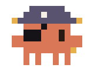

<p align="center">
  <picture>
    <source media="(prefers-color-scheme: dark)" srcset="assets/crab-dark.svg">
    
  </picture>
</p>

# claude-ribbon

A free mod for Claude Code. It adds a glowing purple ribbon above your prompt that shows Claude's task list as it works:

- **A dot ribbon** that lights up purple from the left as steps get done. A pill rides the front edge and says how many are done.
- **The step Claude is on**, like `4/6 Writing the mod`.
- **What Claude is doing right now**, like `Editing register.tsx`.
- **A pixel crab in a pirate costume.** It sways while Claude works and rests when Claude stops.
- **A Show button** that opens the full step list.

<p align="center">
  <picture>
    <source media="(prefers-color-scheme: dark)" srcset="assets/band-dark.svg">
    
  </picture>
</p>

Press **Show** to see every step:

<p align="center">
  <picture>
    <source media="(prefers-color-scheme: dark)" srcset="assets/steps-dark.svg">
    
  </picture>
</p>

## Where it works

The ribbon reads the task list that Claude keeps in the **Claude desktop app** (the Code tab). It shows up whenever Claude makes a plan there. A plain terminal session has no such task list, so the ribbon stays hidden there.

## Install

In a Claude Code terminal session, type:

```
/plugin install progress-glow --marketplace omaird/claude-ribbon
```

1. Type `y` when it asks `Add marketplace?`.
2. Pick the **user** scope with Enter.
3. Open the Claude desktop app and start a new session in the Code tab.

From a shell, the same thing in one line:

```bash
claude plugin install progress-glow --marketplace omaird/claude-ribbon
```

Or in the desktop app: click **+** next to the prompt box, then **Plugins**, then **Add marketplace** with `omaird/claude-ribbon`, then **Add plugin**.

## What you see

| Part | What it means |
| --- | --- |
| Lit purple dots | Work that is done. The newest stretch lights up left to right when a step finishes. |
| Faint grey dots | Work that is still waiting. |
| `Tasks 3/6` pill | How many steps are done. It slides forward as steps finish. |
| `4/6 Writing the mod` | The step Claude is on now. |
| `⟡ Editing register.tsx` | What Claude is doing this second. It goes away when Claude stops. |
| Show / Hide | Opens or closes the full step list: ✓ done, ◆ now, ○ waiting. |

Other things it does:

- It follows the app's light or dark mode.
- On a narrow window it drops the live action first, then the dot ribbon. The step and the Show button always stay.
- It stops all animation when your computer is set to reduce motion.
- When every step is done it says `all done`. The next prompt clears it.

## Goes well with the session line

[claude-session-sentence](https://github.com/omaird/claude-session-sentence) puts one line above the prompt that says what the session is about, with More for the goal, what is done and what is next. With both installed, the session line sits on top and the ribbon sits below it.

## How it is built

The mod is two TypeScript files and no build step. Claude Code loads `hooks/register.tsx` as it is.

| File | What it does |
| --- | --- |
| `hooks/register.tsx` | Watches Claude's tool calls. When Claude updates its task list, it saves the steps. When Claude reads or edits a file, it saves a short line about it. Then it draws the ribbon above the prompt. |
| `hooks/art.ts` | Draws the crab and the dot ribbon as animated SVG. The dot pattern comes from a small hash, so the same steps always draw the same dots. |
| `types/index.d.ts` | The shape of the saved state: the steps, the live action, and whether the list is open. |
| `tests/band.test.tsx` | Checks that the ribbon follows the task list and the live action, in the terminal and in the desktop app. |
| `.claude-plugin/plugin.json` | The mod's name and description. |
| `.claude-plugin/marketplace.json` | Makes this repo installable with one line. |
| `scripts/previews.ts` | Draws the pictures in this README from the mod's own art code. |

The ribbon only watches. If something goes wrong inside it, the tool call goes on as normal.

## Change it

Clone the repo and load your copy for one session:

```bash
git clone https://github.com/omaird/claude-ribbon.git
```

```bash
claude --plugin-dir ./claude-ribbon
```

To load it in the desktop app, add the folder's full path to `CLAUDE_CODE_PLUGIN_DIRS` in the `env` block of `~/.claude/settings.json`.

Check and test it:

```bash
claude plugin validate ./claude-ribbon
```

```bash
claude plugin test ./claude-ribbon
```

Draw the README pictures again after you change the art (needs [Bun](https://bun.sh)):

```bash
bun scripts/previews.ts
```

## Thanks

The look came from [ribbon](https://github.com/robonuggets/ribbon) by Jay E at RoboNuggets, a band that shows usage and cache state. This mod is separate code that shows the task list instead.

This is a fan-made mod. It is not made by or linked to Anthropic.

## License

MIT. See [LICENSE](LICENSE).
